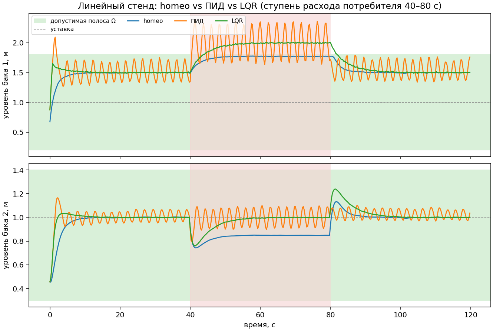
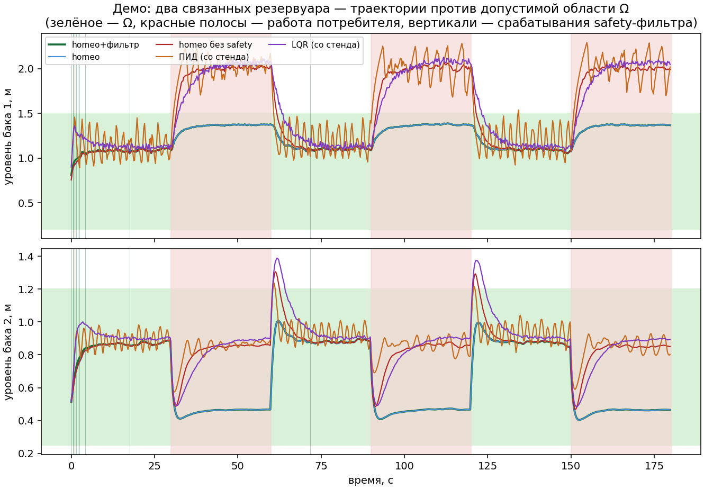
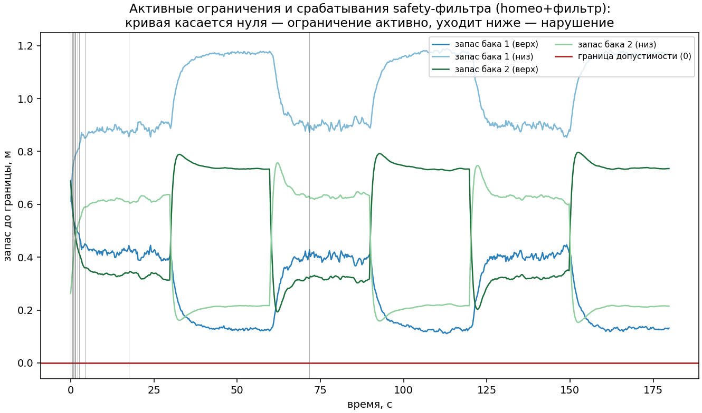
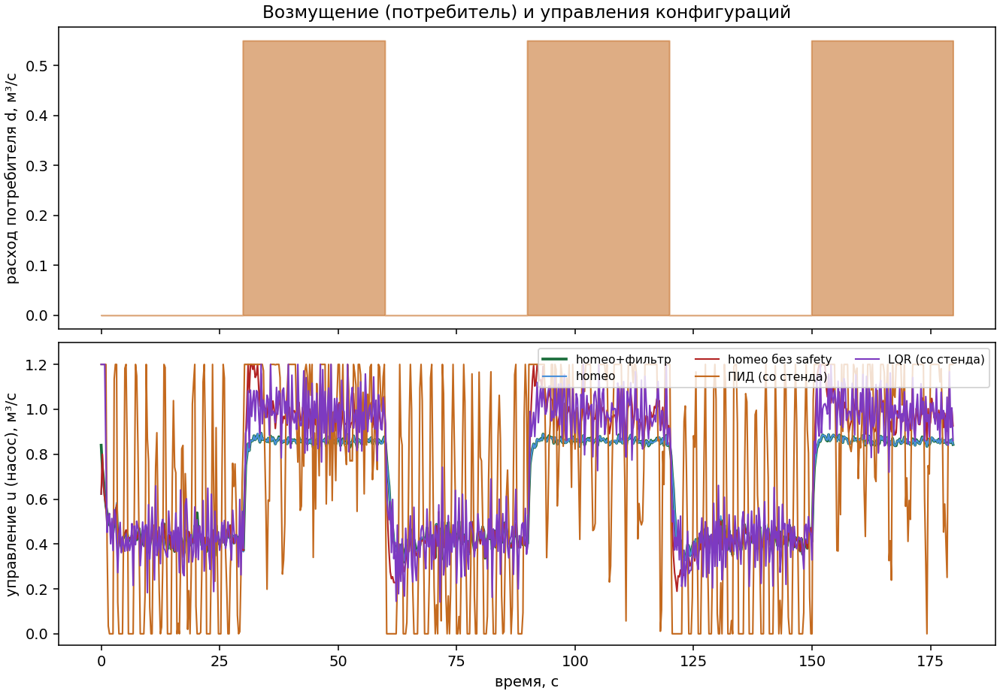

# Валидация homeo: протокол и результаты

Все таблицы и плоты в этом документе сгенерированы **только** из
`results/*.json` этого репозитория (эксперименты `experiments/`). Числа ниже
получены прогоном `python experiments/run_all.py` в окружении, описанном в §1;
повторный прогон воспроизводит все `results/*.json` байт‑в‑байт (фиксированные
seed'ы). Формальная постановка (состояние, Ω, ядро, safety‑фильтр) —
в `docs/formal-setup.md`.

**Что это валидация, а чем не является.** Это симуляционное сравнение
конфигураций контроллера на двух модельных объектах с фиксированными
сценариями возмущений. Выводы — **относительные** («на этом стенде и этих
сценариях конфигурация A держит Ω, а B — нет»), а не абсолютные гарантии:
никакой инвариантности, устойчивости или робастности здесь не доказано
(см. §7 и раздел ограничений в `docs/formal-setup.md`).

---

## 1. Окружение и воспроизводимость

Прогон, которому соответствуют все числа (`results/metrics.json`, блок
`environment`):

| параметр | значение |
|---|---|
| ОС | Linux x86‑64 (изолированный CPU‑only сандбокс, ядро 5.10) |
| Python | 3.12.16 |
| numpy / scipy / matplotlib | 2.1.3 / 1.14.1 / 3.9.2 |
| homeo | 0.1.0 (`pip install -e .`) |
| GPU | не используется |
| полное время `run_all.py` | ≈ 258 с (~4.3 мин) |

Детерминизм: **фиксированные seed'ы**. Потоки возмущений и шума датчиков
генерируются заранее в `run_episode` (seed оценки 7, 8, 9 — одинаковые для
всех контроллеров), ПИД настраивается сеткой на отдельном потоке (tuning seed
123), ядро homeo — seed 11. Поэтому сравнение честное (все видят одни и те же
возмущения), а результаты воспроизводимы на любой машине; от скорости CPU
зависит только время прогона, не числа.

Воспроизведение:

```bash
pip install -e ".[experiment]"    # numpy, scipy, matplotlib — только для experiments/
python experiments/run_all.py     # ~4–7 мин; results/*.json + плоты + свод metrics.json
```

## 2. Метрики (определения — `homeo/metrics.py`)

* `violation_count` — число шагов эпизода, на которых нарушено хотя бы одно
  ограничение Ω (глубина выхода > 0);
* `max_violation_depth` — максимальная глубина выхода за полосу, м;
* `overshoot` — max(0, max h2 − ref), выброс над уставкой;
* `settling_time` — первое `t = k·dt`, начиная с которого `|h2 − ref| ≤ 0.02·`
  (ширина полосы бака 2) **до конца окна**; окно — до начала возмущения
  ([0, 40) с на стенде, [0, 30) с в демо): во время возмущения контроллер по
  дизайну жертвует слежением ради допустимости, и это не «незатухший
  переходный процесс»; `null` — не осел в окне;
* `recovery_time` — время от начала возмущения до возврата в Ω (навсегда);
  0.0 — нарушений после начала возмущения не было; `null` — не вернулся;
* `control_effort` — Σ|u|·dt, интеграл модуля управления;
* `filter_triggers` — сколько раз safety‑фильтр заменил кандидата;
* `zero_violation_margin` — робастностный запас: **максимальная проверенная**
  амплитуда возмущения с нулём нарушений (сетка шага 0.1; не монотонная
  оценка — между узлами сетки поведение не проверялось).

## 3. Бейзлайны: линейный стенд (`results/baselines.json`)

Объект — два бака с линейными перетоками (c12 = 0.7, c2 = 0.35), старт
h1 = h2 = 0.5, полосы Ω: h1 ∈ [0.2, 1.8], h2 ∈ [0.3, 1.4], уставка ref = 1.0,
шум датчиков σ = 0.005, привод u ∈ [0, 1.5]. Возмущение — ступень расхода
потребителя 0.35 м³/с на [40, 80) с. Эпизод 480 шагов по dt = 0.25 (120 с).
Среднее по 3 потокам оценки (seed 7, 8, 9).

| контроллер | нарушений Ω | макс. глубина | overshoot | settling, с | recovery, с | effort |
|---|---|---|---|---|---|---|
| **homeo** | **0** | **0.000** | **0.130** | **7.50** | **0.0** | **54.8** |
| ПИД (Kp=12, Ki=0.05, Kd=0.5) | 121 | 0.583 | 0.181 | 39.6* | 45.5 | 57.9 |
| LQR (K = [3.38, 2.28, −1.33]) | 152.7 | 0.211 | 0.236 | 6.33 | 42.0 | 57.3 |

\* ПИД: settling определён на 2 из 3 потоков (39.75 и 39.5), на третьем — `null`;
в таблице среднее по определённым.

Протокол честной настройки: ПИД — лучший из сетки 6×5×3 = 90 комбинаций,
подобранных на **отдельном** тюнинговочном потоке (seed 123) по лексикографике
(нарушения, потом settling, потом effort); LQR спроектирован один раз через
DARE (непрерывная модель → дискретизация ZOH, интегратор ошибки, Q = diag(2, 8,
0.4), R = 0.05) и не перенастраивается. Homeo — фиксированные параметры без
какой‑либо сетки (`horizon=16, lr=0.15, t0=0.02, anneal_k=1.0, w_safe=25,
safety_margin=0.03`).



Чтение результата: ПИД видит только бак 2 и на ступени потребителя
выдавливает бак 1 за верхнюю границу полосы (121 шаг вне Ω, глубина до 0.58 м);
LQR держит глубину нарушения вдвое меньше (0.211), но тоже систематически
выходит за Ω (в среднем 152.7 шага из 480). Homeo с барьерными шарнирами по
предсказанной траектории проходит все 3 потока без единого шага вне Ω и без
срабатываний фильтра, а по settling (7.5 с) и effort (54.8) сопоставим с
базлайнами или лучше — т.е. безопасность здесь куплена не ценой качества
слежения.

## 4. Робастность (`results/robustness.json`)

Три протокола на том же стенде (подробности протоколов — в шапке
`experiments/run_robustness.py`).

### 4.1. Развёртка амплитуды ступени потребителя (d = 0.1 … 1.2 м³/с, шаг 0.1)

Запас = максимальная **проверенная** амплитуда с 0 нарушений (сетка шаг 0.1):

| конфигурация | запас, м³/с | первая нарушающая амплитуда |
|---|---|---|
| homeo (полная) | **0.7** | 0.8 |
| homeo без safety‑инвариантов | 0.2 | 0.3 |
| homeo без safety‑инвариантов **+ safety‑фильтр** | **0.8** | 0.9 |
| ПИД (сетка) | 0 | 0.1 |
| LQR | 0.2 | 0.3 |

Два вывода. Первый — архитектурный: даже конфигурация **без** барьерных
инвариантов с внешним фильтром даёт лучший запас (0.8), чем полная homeo
(0.7) — фильтр с worst‑case профилем d_bound = d сильнее, потому что знает
границу возмущения проекта. Второй — честный: за границей запаса все
конфигурации нарушают Ω (для homeo при d = 0.8 — 7 шагов, при d = 1.2 — 158),
т.е. ни один слой здесь не даёт инвариантности, только запас.

### 4.2. Шум датчиков σ ∈ {0, 0.01, 0.02, 0.05} м (при d = 0.35)

| контроллер | σ=0 | σ=0.01 | σ=0.02 | σ=0.05 |
|---|---|---|---|---|
| **homeo: нарушений** | **0** | **0** | **0** | **0** |
| ПИД: нарушений | 119 | 135 | 141 | 153 |
| LQR: нарушений | 152 | 152 | 152 | 150 |

Homeo держит 0 нарушений во всей проверенной шкале шума. Побочный эффект:
при σ = 0.05 settling homeo на окне до возмущения деградирует с 7.5 до 36.5 с
(зашумлённая оценка возмущения d_hat замедляет слежение), при этом допустимость
не нарушается ни разу — приоритет «сначала Ω, потом уставка» работает как
задумано.

### 4.3. Дрейф параметра объекта: c2 линейно падает на 30 % за эпизод, d = 0.35

| контроллер | нарушений Ω | макс. глубина | overshoot | effort |
|---|---|---|---|---|
| **homeo** | **0** | **0.000** | 0.187 | 49.3 |
| ПИД | 112 | 0.536 | 0.257 | 51.5 |
| LQR | 144 | 0.136 | 0.254 | 51.0 |

Дрейф параметра (засорение стока) для homeo даже дешевле по усилию: оценка
d_hat впитывает несоответствие модели объекту, и контур компенсирует его
интегралоподобным поведением без нарушения Ω.

## 5. Абляции (`results/ablation.json`) — включая честный отрицательный результат

Линейный стенд с усиленной ступенью d = 0.5, поток seed 7. Каждая абляция
выключает **один** механизм (см. шапку `experiments/run_ablation.py`):

| вариант | выключено | нарушений Ω | макс. глубина | overshoot | settling, с | effort |
|---|---|---|---|---|---|---|
| full | — | **0** | 0.000 | 0.134 | 7.50 | 58.9 |
| no_noise | t0 = 0 (термальный шум) | 0 | 0.000 | 0.134 | 7.50 | 58.9 |
| no_anneal | anneal_k = 0 (шум без затухания) | 0 | 0.000 | 0.078 | 7.00 | 58.1 |
| fixed_gain | Adam → GD с фиксированным шагом | 0 | 0.000 | 0.094 | 7.50 | 57.9 |
| no_adaptive_h | h_doublings = 0 (шаг градиента фиксирован) | 0 | 0.000 | 0.134 | 7.50 | 58.9 |
| no_projection | project = false (без обрезки в ящик) | 0 | 0.000 | 0.134 | 7.50 | 58.9 |
| **no_safety** | **барьерные шарниры полос** | **163** | **0.423** | 0.340 | 7.25 | 63.0 |

**Отрицательный результат (его важно не спрятать):** на линейном стенде
термальный шум, annealing, адаптивный шаг численного градиента и проекция в
ящик почти не влияют на исход — метрики совпадают с полной конфигурацией до
третьего знака или лучше (no_adaptive_h и no_projection дают буквально те же
числа, что full). Единственная абляция, которая реально ломает безопасность —
**no_safety** (163 шага вне Ω, глубина 0.423, recovery 42.25 с против 0 у
полной). Т.е. на этом классе задач безопасность обеспечивают именно
safety‑инварианты (и/или фильтр — §4.1), а стохастическая часть релаксации —
не «магия безопасности», а механизм пере‑балансировки инвариантов, эффект
которого на гладком одномерном ландшафте энергии неотличим от простого
спуска. Обобщение на другие ландшафты (многомерный X, невыпуклые энергии)
этой валидацией не проверялось.

## 6. Демо: нелинейные баки, смещённая модель (`results/demo.json`)

Сценарий: квадратичные перетоки (k12 = 0.9, k2 = 0.45), старт h1 = h2 = 0.6,
полосы Ω: h1 ∈ [0.2, 1.5], h2 ∈ [0.25, 1.2], ref = 0.9, шум σ = 0.02,
привод u ∈ [0, 1.2]. Возмущение — потребитель 0.55 м³/с меандром (период
60 с, скважность 50 %). Честная неопределённость: номинальная модель
контроллера **смещена** (k12 = 0.85, k2 = 0.40), профиль потребителя
неизвестен (фильтр знает только границу 0.55). ПИД и LQR — со стенда, без
перенастройки. Эпизод 720 шагов по dt = 0.25 (180 с), поток seed 7.

| конфигурация | нарушений Ω | макс. глубина | overshoot | settling, с | recovery, с | effort | срабатываний фильтра |
|---|---|---|---|---|---|---|---|
| **homeo + фильтр** | **0** | **0.000** | 0.107 | 27.75 | 0.0 | 115.5 | **11** |
| homeo (без фильтра) | 0 | 0.000 | 0.108 | 27.50 | 0.0 | 115.4 | 0 |
| homeo без safety | 360 | 0.564 | 0.406 | 27.75 | null | 125.7 | 0 |
| ПИД (со стенда) | 363 | 0.794 | 0.340 | null | null | 127.1 | 0 |
| LQR (со стенда) | 366 | 0.630 | 0.490 | 10.00 | null | 127.0 | 0 |

Смещённая модель + нелинейная физика + периодический потребитель: барьерные
инварианты по предсказанной траектории и без фильтра удерживают 0 нарушений
(смещение модели съедается оценкой d_hat); фильтр сработал 11 раз — заменил
кандидата до того, как предсказание ушло за границу (максимальная глубина
нарушения у отклонённых кандидатов 0.095 м), ни разу не дошло до best‑effort
(`filter_blocked_best_effort = 0`). Базлайны, у которых нет модели последствий,
находятся вне Ω примерно половину эпизода (360–366 шагов из 720).





## 7. Ограничения валидации

1. **Относительное, не абсолютное.** Все сравнения — на двух модельных
   объектах и фиксированных сценариях; на другом объекте, другом профиле
   возмущений или другой сетке амплитуд запасы (§4.1) могут быть иными
   (запас — по узлам сетки шага 0.1).
2. **Симуляция.** Объект — явный Эйлер с известной структурой; шум —
   гауссовский, возмущения — ступень/меандр/линейный дрейф. Реальные датчики,
   запаздывания и неструктурированные возмущения не моделировались.
3. **Одномерное управление.** Все протоколы — скалярный u (насос); векторный
   случай, как и фильтр для вектора управлений, не валидировался.
4. **Настраиваемые параметры homeo не перебирались.** Homeo выступает с
   одной фиксированной конфигурацией против настроенных базлайнов; это
   консервативно по отношению к homeo в бейзлайнах (§3), но не гарантирует,
   что конфигурация оптимальна.
5. **Малое число потоков оценки.** Бейзлайны — среднее по 3 seed'ам; разброс
   между потоками мал (например, ПИД: 39.75/39.5/null по settling), но
   статистическая значимость различий не оценивалась.
